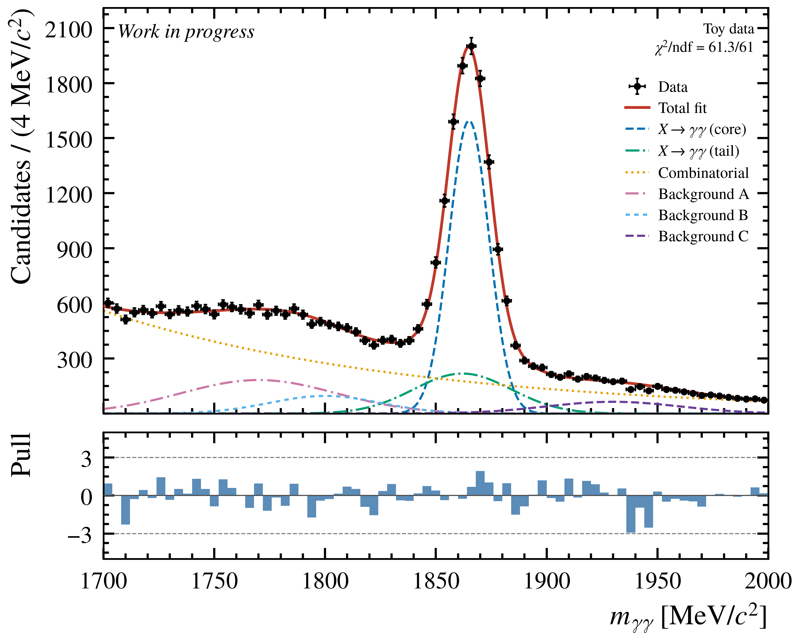
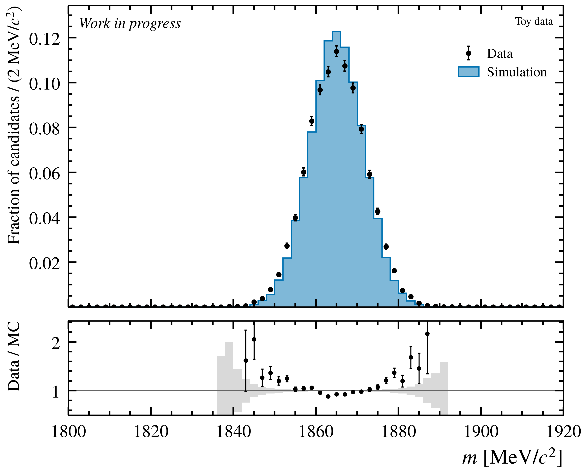
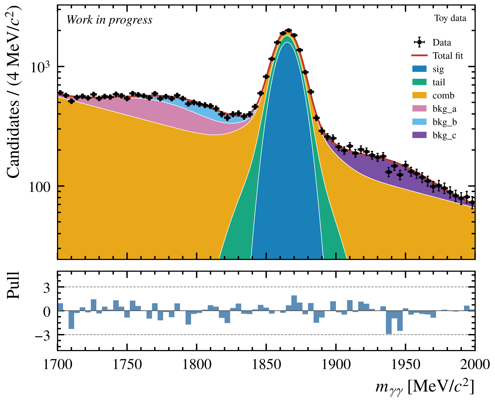
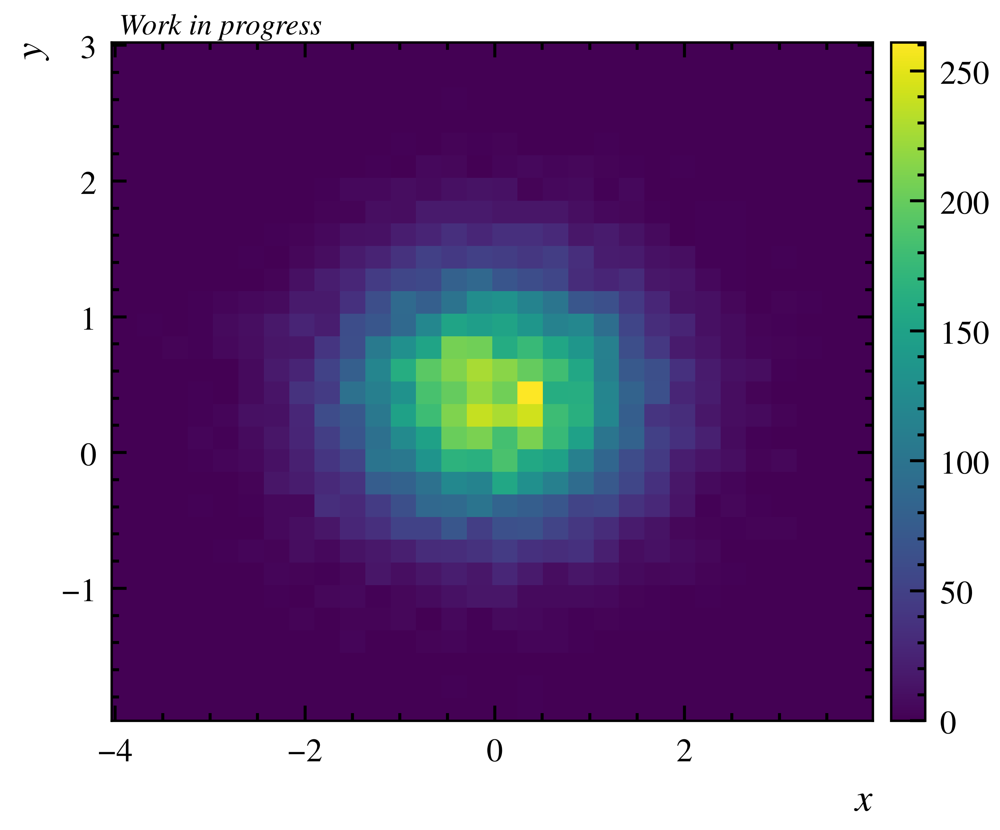

# Figuratively

**Publication-quality plots straight from ROOT files, with no ROOT installation.**

[](https://pypi.org/project/figuratively/) [](https://pypi.org/project/figuratively/) [](https://github.com/abhishekLHCb-CERN/figuratively/actions) [](https://github.com/abhishekLHCb-CERN/figuratively/blob/main/LICENSE)

<!-- Before the first release replace the relative image paths below with absolute raw URLs pinned to the
     release tag (PyPI does not resolve relative paths):
     https://raw.githubusercontent.com/abhishekLHCb-CERN/figuratively/v1.1.0/docs/img/01_fit_components.png -->



*Toy data. One call: `fg.plot("fit.root:canvas")`.*

## Install

```bash
pip install figuratively
```

## Quick start

```python
import figuratively as fg

fg.plot("fit.root:canvas")                          # data, total, every component, pulls
fg.plot("f.root:h_data", "f.root:h_mc")             # data against simulation, ratio panel added
fg.plot("f.root")                                   # every histogram, graph and canvas in the file
fg.plot("fit.root:canvas", logy=True, stack=True, xlim=(1800, 1900), info="2018 data")
```

```bash
figly fit.root:canvas                               # the same from the shell (also: figuratively ...)
figly ls fit.root                                   # list the objects in a file
figly f.root:h_data f.root:h_mc -s logy=True -o out.pdf
```

Plots are written to a `plots/` folder next to the ROOT file as PDF and PNG. `fg.plot` returns a `Plot`
object, so anything it does not do automatically can still be changed afterwards.

## What it does for you

- Reads RooFit canvases, histograms (1D and 2D), profiles and graphs with uproot and matplotlib. No ROOT needed.
- Detects data, total fit, components, axis titles and units (ROOT's `#gamma` and `^{+}` become mathtext).
- Recomputes pulls from the data and the total curve, so a stored pull pad is not required.
- Adds a ratio panel for data against simulation and normalises shapes when the yields differ.
- Places the label, information lines and legend so that they do not sit on top of the data.
- Whole-file mode plots every object, warns about the ones it cannot draw and carries on.
- Typos give "did you mean" errors, not stack traces.

## Using it with ROOT

Figuratively never needs ROOT, but it works alongside it, from Python and from C++.

**From PyROOT** (live objects, no file to save first):
```python
import ROOT, figuratively as fg
fg.plot(canvas)                    # a TCanvas, TPad, TH1, TH2, TGraph or RooPlot you just made
fg.plot(h_data, h_mc)              # overlay with a ratio panel
fg.plot(canvas, logy=True, label="Work in progress")
```
ROOT writes the object to a temporary file and Figuratively reads that file, so every feature (several panels,
colours, pulls, `labels=`, ...) behaves exactly as it does for a saved file. Plots go to `./plots/` unless you pass
`outdir=`.

**From a ROOT macro or C++ program**, one call with the small header that ships with the package:
```bash
figly header figuratively.h        # copies the header next to your code
```
```cpp
#include "figuratively.h"
void make() {
  // ... fill your canvas as usual ...
  Figuratively::Plot(canvas);                                          // pdf + png in the current folder
  Figuratively::Plot(canvas, {"logy=True", "label=Work in progress"}); // any option of fg.plot, as key=value
}
```
Without the header, two lines in any macro do the same: `canvas->SaveAs("c.root"); gSystem->Exec("figly c.root");`.
`figly` must be on the PATH (`pip install figuratively`). Keywords with spaces are fine, because each one is quoted.

Honest note: the PyROOT path and the C++ header are tested against stand-ins (a fake `ROOT` module, and ROOT-like
headers the C++ compiles against), since CI has no ROOT installation. The file path, which is what both of them
use underneath, is tested on real ROOT files.

## Trust the figure: checks and tables

A plot that looks fine can still be wrong. Figuratively checks the numbers behind it and speaks up:

```python
fg.check("fit.root:canvas", nparams=10)   # per panel: data vs curve integral, chi2/ndf, empty bins, largest pull
fg.summary("fit.root", nparams=10)        # one row per panel: entries, chi2/ndf, yield of every component
fg.summary(files, fmt="latex")            # or fmt="csv": ready for a systematics table
```
```bash
figly check fit.root:canvas -s nparams=10
figly summary fit.root -s fmt=csv
```
While plotting, a warning appears when the curve and the data disagree in normalisation, when many pulls exceed 5,
when most bins are empty, when histograms were normalised automatically, when a blinded window still shows the model
curve, and when the canvas holds objects that are not drawn (a `TLegend`, a stats box, a line). `checks=False`
silences them and `strict=True` turns them into errors, for scripts and CI. Pulls follow RooFit's convention
(the curve averaged over each bin); `pull={"mode": "centre"}` uses the bin centre instead.

What the canvas itself says is respected: its log scales, and the frame's x range (which also trims the stub of curve
that RooFit stores beyond the data). A keyword on the call always wins.

## Project defaults

Put your recurring choices in a `figuratively.toml` next to your files (or call `fg.configure(...)`):

```toml
label = "Work in progress"      # text at the top left; nothing is drawn unless you ask for it
exp = ""                        # collaboration name; set it only if you are entitled to use it
com = "13"                      # adds "sqrt(s) = 13 TeV"
lumi = "5.4"
nparams = 14                    # adds chi2/ndf to fit plots
formats = ["pdf", "png"]

[labels]                        # legend text per object or component name
sig = '$X\to\gamma\gamma$'
comb = "Combinatorial"

[colors]
sig = "#0072B2"
```

Every keyword of `fg.plot` is either one of these keys (a per-call override) or a method of `Plot`
(`logy`, `xlim`, `ylim`, `legend`, `font`, `text`, `vline`, `info`, ...). An unknown keyword raises an error.

## Customise when you need to

You never have to. Everything below is optional, and each step is one more keyword on the same call:

```python
fg.plot("fit.root:canvas")                                     # nothing to configure
fg.plot("fit.root:canvas", logy=True, xlim=(1800, 1900))       # a few keywords
fg.plot("fit.root:canvas", components={"sig": "red dashed fill", "bkg*": {"alpha": 0.4}},
        merge={"Backgrounds": ["comb", "bkg*"]}, order=["Backgrounds", "sig"])
fg.plot("fit.root:canvas", blind=(1840, 1890), vline=[(1865, "$m_{D^0}$")], span=(1850, 1880, "signal"),
        size="column", legend="upper left", dpi=300)
p = fg.plot("fit.root:canvas", save=False).logy().param("$N$", 1234, 12)   # chainable Plot methods
p.annotate(lambda fig, ax, rax: ax.axvline(1865, ls=":")); p.save("fig.pdf")
```

Not sure what a canvas contains or what to call things? Ask it:

```python
fg.inspect("fit.root:canvas")      # lists the components and prints a call to copy and edit
fg.options()                       # every option with a one-line description
```
```bash
figly inspect fit.root:canvas      # the same from the shell
figly init fit.root:canvas         # writes figuratively.toml with every detected component pre-filled
```

A typo never passes silently: `lgy=True` and `labels={"sgi": ...}` both say what you probably meant, and
`strict=True` turns such warnings into errors. A component style is a string of plain words (a colour,
`solid dashed dotted dashdot`, `line fill band`, `thin thick`, `alpha=0.4`, `hatch=//`) or a dict.
Settings resolve in this order: keyword on the call, then `figuratively.toml`, then the built-in default.

### Colours, learned from R

A canvas written by a ROOT macro carries its colours as indices (`kRed`, `kGreen+3`, ...), and ROOT's colours
are the saturated primaries of the 1990s. Figuratively reads them and **translates** them instead of copying
them (`root_colors=True`, the default):

- the **hue** is kept, so a red curve in your macro is still a red curve, and ROOT's line styles and fills
  carry over too;
- the lightness is squeezed into a band that reads well on white and the chroma is capped, so nothing screams
  and nothing vanishes. The light-to-dark order of ROOT's shades (`kRed-4` ... `kRed+3`) is preserved;
- colours that end up too similar (three shades of orange in one canvas, say) are moved apart until they
  are clearly distinguishable, measured in the perceptual OKLab space.

This follows what R did: its 4.0 release replaced the old garish default palette with tamed tones, and its
`hcl.colors` builds palettes from evenly spaced hues at equal lightness. For components without a ROOT colour
(or with `root_colors=False`) pick a palette with `palette="r4"`, `"okabe-ito"` (colour-blind safe),
`"tableau10"`, `"dark2"` or `"hcl"`. Every palette is extended with evenly spaced HCL hues, so thirty
components never repeat a colour. `fg.root_color(632)` and `fg.palette("hcl", 12)` give you the colours directly.

The ROOT colour table was extracted programmatically from the public JSROOT source, so no value is typed by hand.

### All options

<!-- options:start -->
**Fit components**

| Option | Effect |
|---|---|
| `components` | per-component style: {'sig': 'red dashed fill', 'bkg*': {'alpha': .4}} |
| `labels` | rename legend entries: {'sig': 'Signal', 'data': 'Data', 'total': 'Fit'} or just a list in legend order ['Data', 'Fit', 'Signal', ...] |
| `colors` | colour per object or component: {'sig': '#0072B2'} |
| `styles` | full per-component style dicts: {'comb': {'kind': 'fill', 'hatch': '//'}} |
| `comp_kind` | default drawing style of every component: 'line', 'fill' or 'band' |
| `merge` | sum several components into one entry: {'Backgrounds': ['comb', 'bkg*']} |
| `hide` | regular expressions of components to leave out |
| `order` | component order in the legend and the stack |
| `stack` | stack the components as filled areas |
| `root_colors` | True takes colours, line styles and fills from the ROOT objects (refined, and kept visibly apart); 'components' leaves the total in the house colour; False ignores ROOT |
| `palette` | colours for components without a ROOT colour: figuratively, r4, okabe-ito, tableau10, dark2, hcl |

**Panels**

| Option | Effect |
|---|---|
| `pull` | False to drop the pull panel, or a dict of Plot.pull options: {'ylim': (-4, 4), 'mode': 'centre'}; the range grows beyond +-5 by itself when the pulls are larger |
| `nparams` | number of fit parameters; adds chi2/ndf to the info block |
| `ratio` | False to drop the ratio panel, or its y-range: (0.7, 1.3) |
| `pull_label` | y-label of the pull panel |
| `ratio_label` | y-label of the ratio panel |

**Histograms**

| Option | Effect |
|---|---|
| `normalise` | normalise every histogram to unit area |
| `rebin` | merge N neighbouring bins |
| `kind` | drawing style of histograms: 'step', 'fill', 'points' or 'band' |
| `data_pattern` | regular expression that marks an object as data |

**Regions, lines and text**

| Option | Effect |
|---|---|
| `blind` | hide data in a window and mark it: (1840, 1890) or [(a, b), (c, d)] |
| `blind_curves` | with blind=: also blank the model curves inside the window |
| `vline` | vertical line(s): 1865, (1865, 'label') or a list of those |
| `hline` | horizontal line(s): 100, (100, 'label') or a list of those |
| `span` | shaded window(s): (x0, x1) or (x0, x1, 'label') or a list of those |
| `text` | text at axes fractions: (0.05, 0.9, 'text') or a list of those |
| `canvas_text` | text written on the canvas (e.g. the bin range): True shows it, False hides it, a dict {old: new} edits it, a function f(text, panel) rewrites it (return None to drop) |
| `blind_label` | text inside a blinded band (a window can also carry its own: (lo, hi, 'text')) |
| `info` | small text lines in the top-right block (string or list) |
| `label` | top-left label text, e.g. 'Work in progress' (none by default) |
| `exp` | collaboration name in the label; empty by default, set it only if you are entitled to |
| `com` | centre-of-mass energy in TeV for the label, e.g. '13' |
| `lumi` | integrated luminosity in fb^-1 for the label |
| `data` | False prints 'Simulation' in the label |

**Axes**

| Option | Effect |
|---|---|
| `ylabel_prefix` | start of the automatic y-label, e.g. 'Events' gives 'Events / (2 MeV)' |
| `xlim` | x range (lo, hi); None keeps a side automatic |
| `ylim` | y range (lo, hi) |
| `xrange` | alias of xlim |
| `yrange` | alias of ylim |
| `logx` | logarithmic x axis |
| `logy` | logarithmic y axis |
| `log` | 'x', 'y' or 'xy': shorthand for logx / logy |
| `xlabel` | x label, or (text, unit) |
| `ylabel` | y label (default is generated from the bin width) |
| `unit` | unit used in the axis labels and the bin-width label |
| `scale_x` | multiply the x axis, e.g. 1e-3 for MeV to GeV (set unit= too) |
| `title` | figure title |
| `grid` | draw a grid |
| `headroom` | factor of free space above the data |

**Figure**

| Option | Effect |
|---|---|
| `tone` | overall look: colour (default), mono (greys and line styles, for print) or dark (light on dark, for slides) |
| `preset` | a named bundle of settings: thesis, paper, slides, poster, or one of your own from the [presets.NAME] tables of figuratively.toml; the call's own keywords always win |
| `presets` | your own presets as a dict {name: {option: value}} (usually written in figuratively.toml) |
| `size` | figure size (w, h) in inches or a preset: 'column', 'double', 'slide' |
| `figsize` | alias of size |
| `font` | scale every text size |
| `legend` | False, a location string, or a dict(loc=, ncol=, title=) |
| `style` | mplhep style name or path of a .mplstyle file |
| `data_label` | legend text of the data |
| `total_label` | legend text of the total fit |

**Output**

| Option | Effect |
|---|---|
| `formats` | file formats to write |
| `suffix` | text added to the automatic file name, so variants do not overwrite each other: '_stack_log' |
| `checks` | warn about a curve that does not match the data, huge pulls, a leaking blind window, silent normalisation and objects of the canvas that are not drawn (False silences them) |
| `view` | open the saved figure in your default viewer when done |
| `outdir` | folder for the output, relative to the ROOT file |
| `dpi` | resolution of raster output |
| `transparent` | transparent background |
| `strict` | turn warnings about unmatched names into errors |
<!-- options:end -->

For finer control use the `Plot` class directly: `fg.Plot().add(...).ratio().label(...).save(...)`, or the
raw matplotlib objects `p.fig`, `p.ax` and `p.rax`.

## More than one plot: trees, grids, comparisons, tones

```python
h = fg.tree("f.root:DecayTree", "D0_M", bins=60, range=(1800, 1930), cut="D0_PT > 2000 and nTracks < 400")
fg.plot(h)                                    # a TTree (or RNTuple) branch is a histogram like any other
fg.plot(h, fg.tree("g.root:DecayTree", "D0_M", bins=60, range=(1800, 1930)))   # overlay two, with a ratio panel
fg.grid(h, ("f.root:data", "f.root:mc", {"normalise": True}), "f.root:corr", shape=(1, 3), out="all.pdf")
fg.compare("nominal.root:canvas", "variant.root:canvas", names=["nominal", "variant"])
fg.plot("runs/*.root:canvas")                 # a pattern or a list of files: one plot each
fg.plot("fit.root:canvas", tone="dark")       # or tone="mono" (greys and line styles, for print)
```

```bash
figly tree f.root:DecayTree D0_M -s bins=60 -s "range=(1800,1930)" -s "cut=D0_PT > 2000"
```

- `fg.tree(spec, expr, bins, range, cut, weight)` accepts a branch or an expression (`"D0_PT / 1000"`). Cuts and
  expressions use a checked mini-language (branch names, numbers, comparisons, `and`/`or`/`not`, `+ - * / **`,
  `abs sqrt log log10 exp`); nothing is ever run with `eval`.
- `fg.grid` draws every cell into one vector figure. A cell is a spec, a histogram, or a tuple to overlay; end a
  cell with a dict to give that panel its own options.
- `fg.compare` overlays several fits of the same data with one ratio panel per fit against the first.
- `tone` and the presets `mono` and `dark` change the look as a whole; `thesis`, `paper`, `slides` and `poster`
  set size and formats.

## Gallery

Every image below is produced by a script in `examples/gallery/` from toy data with a fixed random seed.

| | |
|---|---|
|  |  |
|  | |

## Notes

- No collaboration label is drawn unless you ask for one with `label=` and `exp=`. Figuratively is not
  affiliated with or endorsed by any experiment; using a collaboration label is your responsibility.
- Canvases are read through a fallback, because uproot cannot parse `TCanvas` directly. If a canvas fails to
  load, the error says so; saving the `RooPlot` or the histograms themselves always works.
- Built on [uproot](https://github.com/scikit-hep/uproot5) and [mplhep](https://github.com/scikit-hep/mplhep)
  (both BSD-3-Clause) and matplotlib.

## Licence

MIT. See `LICENSE`.

## Credit and citation

Figuratively is written and maintained by **Abhishek Bohare**, with AI assistance (Claude Code); see `AUTHORS.md`.
If it helps your work, please cite it (`CITATION.cff` and `.zenodo.json` are understood by GitHub and Zenodo):

> Bohare, A. (2026). *Figuratively: publication-quality plots from ROOT files* (version 1.1.0).

Each GitHub release is archived on [Zenodo](https://zenodo.org/), which issues a citable DOI per version plus one
concept DOI for all versions. Cite the DOI of the version you used; the DOI badge and the line above are updated
with it from the first release made after archiving was switched on.

## Safety

No network access, no telemetry, no shell. Configuration files are used only if you own them and nobody else can
write to them, and they can only set documented options. Open only ROOT files you trust. Details in `SECURITY.md`.
